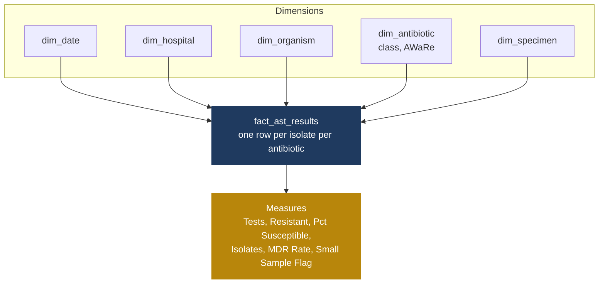

# kaduna-amr-powerbi · dashboards

Power BI data model, measures and reports for Kaduna AMR Watch. This is where everything the project produces reaches the people who decide what a patient receives.

> **The data here is synthetic.** Every page carries a SYNTHETIC banner and is not for clinical use.

---

## The audience decides the design

A doctor on a ward round, often on a phone, often with poor connectivity, has about ten seconds. If the screen cannot be read in that time it will not be used, and every other repository in this organisation was wasted effort.

A hospital manager wants something different: turnaround times, multidrug-resistance by ward, data completeness. These are separate pages, not one page trying to serve both.

---

## Data model

---

## Measure rules

| Rule | Reason |
|---|---|
| Use `DIVIDE([Resistant], [Tests])`, never a stored percentage column | Percentages cannot be averaged. A hospital at 90% on 10 tests and one at 50% on 1,000 tests average to 70%, when the true combined figure is about 50%. |
| Count isolates with `DISTINCTCOUNT(isolate_id)` | The fact table holds roughly ten rows per isolate. |
| Turn off implicit measures | Otherwise dragging a raw column into a chart silently produces a sum where a count belongs. |
| Every visual shows the count behind the percentage | A figure from 5 isolates must not look like a figure from 500. |
| Grey out anything under 30 isolates | Standard antibiogram practice. Below that the percentage is not reliable enough to guide treatment. |

---

## Pages

1. **Antibiogram.** Organisms as rows, antibiotics as columns, percent susceptible in each cell. Green high, red low, grey where fewer than 30 were tested. Filters for hospital, specimen, year and ward. Urine and blood must be separable, because the organism mix differs.
2. **Which antibiotic first.** For a chosen specimen and ward, antibiotics ranked by percent susceptible with their WHO AWaRe group shown, so a working Access drug is visibly preferred over a Watch or Reserve drug.
3. **Management view.** Tests per month, turnaround time by hospital, multidrug-resistance by ward, data completeness.
4. **Evidence page.** Built only from the real, cited evidence register. Real and synthetic figures never share a page.

Both clinical pages need a phone layout.

---

## Before anything is shown to a clinician

- [ ] Every measure validated against the answer key.
- [ ] SYNTHETIC banner visible on every page.
- [ ] Tested on at least two people who do not work in data, watching where they hesitate.
- [ ] Meaning never depends on colour alone.
