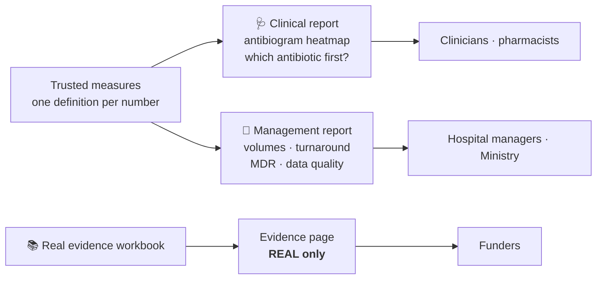

<div align="center">

# 📊 Kaduna AMR Watch — Dashboards

**A screen a clinician understands in ten seconds, and a story a manager or funder can act on.**


</div>

> [!IMPORTANT]
> **SYNTHETIC PRACTICE DATA, NOT FOR CLINICAL USE.** This banner appears on every report page.

## Who reads what



> [!CAUTION]
> Real and synthetic numbers never appear on the same page.

## Design rules

| Rule | Why |
|---|---|
| Fewer than 30 isolates → grey cell | A percentage from 5 isolates looks as solid as one from 500 |
| Count in every tooltip | No percentage without its count |
| `DIVIDE([Resistant],[Tests])`, never an average of percentages | Averaging percentages gives wrong totals |
| Implicit measures turned off | Nobody can drag a raw column into a chart and get a silent sum |
| AWaRe group next to every antibiotic | A working Access drug should be visibly preferred over Watch or Reserve |
| Meaning never depends on colour alone | Colour-blind clinicians must read it correctly |

## Validation

Before any visual is built, measures must reproduce sheet `11_ANSWER_KEY` of the [Clean Handoff Pack](https://github.com/AMR-Playbook/.github/releases/tag/excel-handoff-v2). With *E. coli*, ceftriaxone and 2024 selected, % resistant must read **61.7% (n = 326)**.

## Layout

```
reports/      Power BI project files (.pbip preferred, so changes can be reviewed in Git)
measures/     DAX measure library with plain-English documentation
design/       sketches, wireframes, style guide, user-test notes
briefs/       monthly brief template, evidence page notes, demo material
```

> [!TIP]
> Save reports as a **Power BI Project (`.pbip`)** rather than a single `.pbix`. It stores the model and report as text files, so reviewers can see exactly what changed.

## Getting started

1. Install Power BI Desktop (Windows).
2. Connect with the **read-only** database role from `kaduna-amr-sql`, or the Clean Handoff Pack until the database is ready.
3. Pick an [open issue](../../issues) and read [CONTRIBUTING](https://github.com/AMR-Playbook/.github/blob/main/CONTRIBUTING.md).
